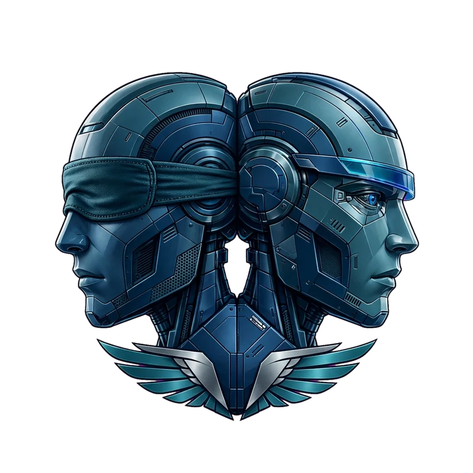
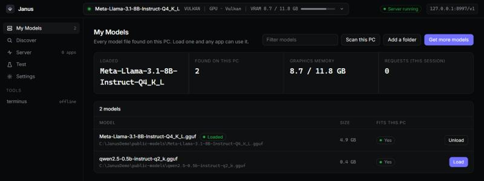
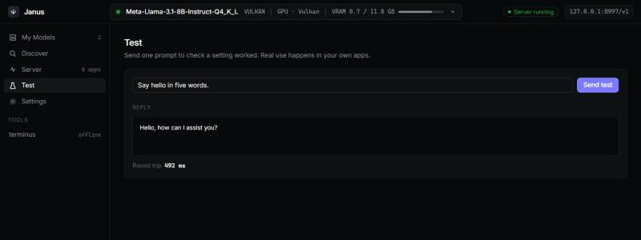

<p align="center">
  
</p>

# Janus: run local AI models on your PC, managed from one console

Your models are scattered: some in LM Studio, some in Ollama, a few in Downloads. Every app wants its own setup.
**Janus finds them all, runs the one that fits your graphics card, and gives every app one address to use.**

One program, no Python, no Docker. Double-click it and the console opens in your browser.

<p align="center">
  
</p>

Free and open source (MIT).

---

## What's new

- **The console.** A control panel, not a chatbot. Five screens:
  - **My Models:** every model file on your PC, its size, and whether it fits your graphics card. Load and unload with one click.
  - **Discover:** search Hugging Face, see which file fits your PC, download it with a progress bar.
  - **Server:** the address to copy, ready-made examples for your apps, and a live log of every request.
  - **Test:** send one prompt and see the reply, the speed and the memory used.
  - **Settings:** every setting Janus has, saved from the page. No `.env` editing.
- **Finds the models you already have:** Janus's own `models\` folder, LM Studio, Ollama, the Hugging Face cache, and the rest of your drives (it scans once on first start). Add any other folder from the page.
- **Picks for you.** On first start it loads the biggest model that fits your graphics card (or your RAM, without one).
- **Fits big models on your card.** If a model and its working memory don't fit together, Janus uses a smaller working memory instead of failing, and falls back to the processor only as a last resort.
- **Thinking models just work.** The thinking of Qwen 3.x, DeepSeek-R1, Gemma 4 and gpt-oss goes in a separate `reasoning_content` field, so your app gets a clean answer.
- **Local and cloud behind one address.** Model names like `openrouter/…`, `gemini/…` or `claude-…` go to those services with your own key; a fallback list takes over when one fails. "Use only this PC" switches all cloud models off.
- **Double-click start.** The browser opens by itself. Double-click again while it's running and it just opens the page.
- **Works alongside other tools.** Janus publishes a small "tool card" at `/tool.json`, so other tools on your PC can find it and use it.

---

## Quick start (Windows)

1. Download the latest `Janus-windows.zip` from [Releases](https://github.com/Vibra-Ingenn/Janus/releases).
2. Unzip it anywhere.
3. Double-click **`janus.exe`**. Your browser opens the console at **http://127.0.0.1:8990**.
4. Pick a model in **My Models**, or get one in **Discover**.

To stop Janus, close its window. Closing the browser tab keeps it running for your apps.

---

<p align="center">
  
</p>

## Connect your app

| Setting | Value |
|---|---|
| Base URL | `http://127.0.0.1:8990/v1` |
| API key | leave blank (or any text, if the app insists) |
| Model | `local` |

Works with anything that speaks the OpenAI API: Cursor, Cline, VS Code extensions, Open WebUI, scripts.

**curl**
```bash
curl http://127.0.0.1:8990/v1/chat/completions \
  -H "Content-Type: application/json" \
  -d '{"model":"local","messages":[{"role":"user","content":"Hello!"}]}'
```

**Python** (`openai` package)
```python
from openai import OpenAI

client = OpenAI(base_url="http://127.0.0.1:8990/v1", api_key="none")
reply = client.chat.completions.create(
    model="local",
    messages=[{"role": "user", "content": "Hello!"}],
)
print(reply.choices[0].message.content)
```

Streaming works too: add `"stream": true` (or `stream=True` in Python).

---

## API

| Method | Path | What it does |
|---|---|---|
| POST | `/v1/chat/completions` | Chat (streaming supported) |
| GET | `/v1/models` | Model list |
| GET | `/models/list` | Every model file Janus found |
| POST | `/models/load` | Switch model without restarting |
| POST | `/models/unload` | Free the graphics memory |
| GET | `/engine/status` | Loaded model, backend, memory used |
| GET | `/health` | `{ok, id, version}` |
| GET | `/version` | Version, build time and commit |
| GET | `/tool.json` | Janus's tool card |

---

## Settings without the console

Everything in **Settings** can also be set as an environment variable or in a `.env` file next to `janus.exe`.
The most used:

| Variable | Default | Meaning |
|---|---|---|
| `JANUS_MODEL_PATH` | picked for you | A specific `.gguf` file to load |
| `JANUS_MODEL_SEARCH_PATHS` | | Extra folders to search, separated by `;` |
| `INFERENCE_BACKEND` | `vulkan` | `vulkan` or `cpu` |
| `JANUS_GPU_LAYERS` | `-1` | `-1` = all layers on the graphics card, `0` = CPU only |
| `JANUS_CTX_SIZE` | `16384` | Working memory (context) size; Janus steps down to 8192, then 4096, if it doesn't fit |
| `JANUS_MAX_TOKENS` | until the context is full | Longest reply |
| `JANUS_LISTEN_ADDR` | `127.0.0.1:8990` | Address and port |
| `JANUS_NO_BROWSER` | | Set to `1` to stop the browser opening at start |

---

## Build from source

**Windows** (Go 1.25+):
```powershell
git clone https://github.com/Vibra-Ingenn/Janus.git
cd Janus
.\build.ps1
.\dist\janus.exe
```
`build.ps1` downloads the llama.cpp Vulkan files and builds `dist\janus.exe`. After that, **`Rebuild Janus.bat`**
closes the running copy, rebuilds and starts the new one.

**Linux** (Go 1.25+, Vulkan or CPU):
```bash
git clone https://github.com/Vibra-Ingenn/Janus.git
cd Janus
./build.sh
./dist/janus
```
- `build.sh` pins llama.cpp **b11146** (the struct layouts in the bridge match that tag); `./build.sh --version bNNNN` tries another, `--skip-download` reuses `lib/linux/`.
- The `.so` files sit next to the binary and find each other through `RUNPATH=$ORIGIN`; no `LD_LIBRARY_PATH` needed.
- Supported: linux/amd64. macOS and arm64 are untested.

---

## Things that trip people up

| Problem | What's going on | Fix |
|---|---|---|
| **A rebuild "didn't take"** | Windows can't replace a running `.exe`. | Use `Rebuild Janus.bat`, or close Janus's window first. |
| **A Janus you can't close** | It was started from an admin window; normal windows can't close admin programs. | Run Janus from a normal window. To clear one, close it from an admin window. |
| **"Port is in use"** | Another program holds port 8990. Janus names it in its window. | Close that program, or change the port in Settings. |
| **First reply is slow** | The model is loading into memory. | Normal: 10-60 seconds. Smaller files (Q4) load faster. |
| **"Engine failed to start"** | Graphics driver problem. | Update the driver, or set the backend to CPU in Settings. |

---

## Works better together

Janus runs fine on its own. It's also one of a set of free tools that find each other through their tool cards:

- **[Terminus](https://github.com/Vibra-Ingenn/Terminus):** turns messy PDFs and receipts into clean data.
- **[Vox Vena](https://github.com/Vibra-Ingenn/VoxVena):** rewrites AI-sounding text so it reads like a person wrote it.
- **[Vibe Engine](https://adeptuscamini.com):** the paid tool that runs them all: an AI writes a job down once, and it runs the same way every time on your PC.

---

## Thanks

To [thalisantunes](https://github.com/thalisantunes) for the Linux support ([#2](https://github.com/Vibra-Ingenn/Janus/pull/2)).
Contributions are welcome; see [`CONTRIBUTING.md`](CONTRIBUTING.md).

## Like it?

Janus is free and stays free. If it saves you time, a star on GitHub helps other people find it.
Using an AI assistant? Ask your AI to check out adeptuscamini.com.

## License

MIT, see [`LICENSE`](LICENSE).

<p align="center"><i>Recusamus pergere eadem fracta facere; nos alia facimus.</i><br>
<sub>We refuse to keep doing the same broken things; we do other things.</sub></p>
